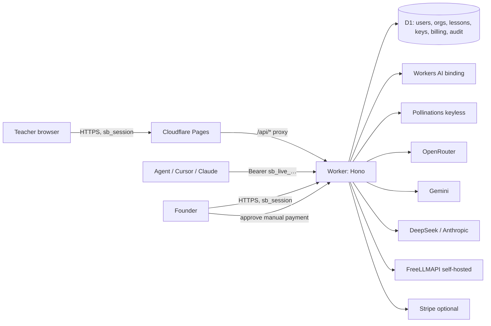
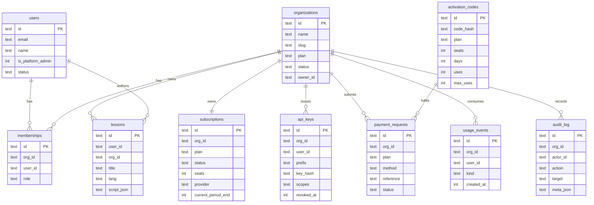
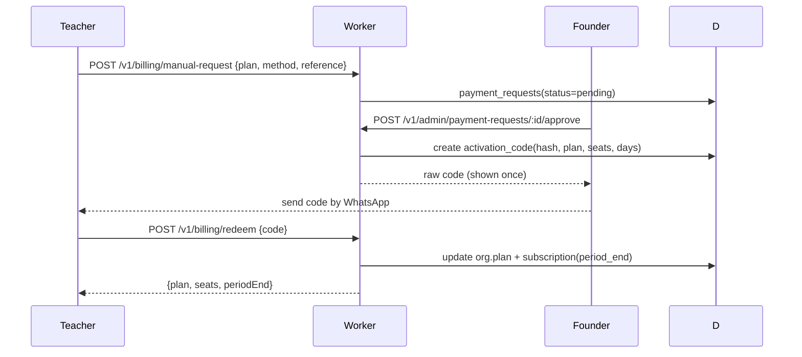
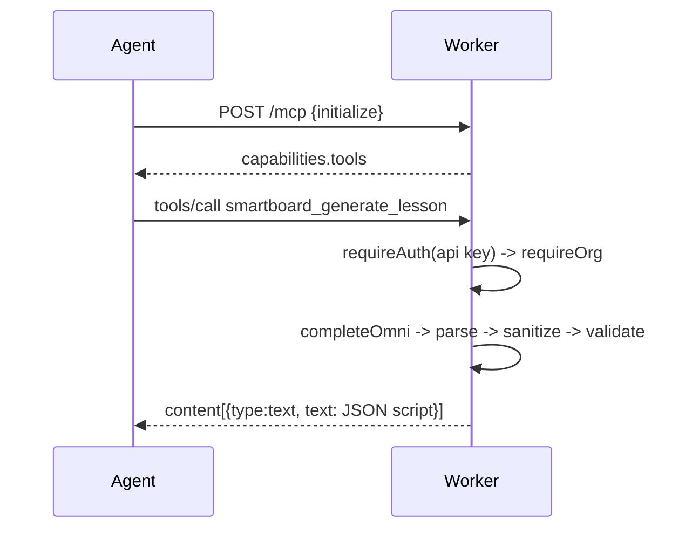

# System Design — SmartBoard AI SaaS

## 1. Design goals

1. **Draw first, talk later.** The board must start drawing before the model finishes; the protocol scanner is the contract.
2. **Zero-key demo, paid-key scale.** A free account must generate a lesson even if no provider key exists.
3. **One workspace, many teachers.** Lessons, keys, quotas, and billing belong to an organization.
4. **Operator visibility.** Every money or access change is auditable.
5. **Arabic-first, global-capable.** RTL is a first-class layout, not a translation layer.

## 2. Context



## 3. Components

| Component | Responsibility | Location |
| :--- | :--- | :--- |
| SPA | Board, Protocol Studio, billing modal | `App.tsx`, `components/` |
| Protocol core | Types, prompt, scanner, validator, parser | `src/protocol/` |
| API worker | Auth, lessons, streaming, keys, billing, admin, MCP | `worker/src/` |
| OmniRouter | Plan-aware provider chain + offline builder | `worker/src/omni.ts`, `providers.ts` |
| D1 schema | Tenants, lessons, usage, subscriptions, audit | `worker/migrations/` |
| Admin console | Founder/co-founder operations | `worker/src/admin.html` at `/admin` |
| Docs | Developer guide + OpenAPI | `worker/src/docs.html` at `/docs` |

## 4. Data model



Key decisions:

- **`org_id` on lessons, runs, usage_events.** Every operational query is tenant-scoped. `user_id` remains for authorship.
- **Plans live in code (`plans.ts`), not a table.** Pricing changes ship with a deploy and cannot drift from enforcement.
- **Subscriptions are one row per org.** `provider = manual | stripe`. Manual activation writes the same row as Stripe, so the app never branches on payment method.
- **Activation codes store only a SHA-256 hash.** The raw code is shown once to the operator and never persisted.
- **API keys store a hash + display prefix.** `sb_live_` prefix makes leak detection easy.

## 5. Request flows

### 5.1 Register

```mermaid
sequenceDiagram
  participant B as Browser
  participant W as Worker
  participant D as D1
  B->>W: POST /auth/register
  W->>D: insert user (is_platform_admin if email allowlisted)
  W->>D: insert organization + owner membership + free subscription
  W->>D: insert session
  W-->>B: Set-Cookie sb_session; {user, org, plan}
```

### 5.2 Generate a lesson (SSE)

```mermaid
sequenceDiagram
  participant B as Browser
  participant W as Worker
  participant O as OmniRouter
  participant P as Provider
  B->>W: POST /v1/chat/stream {model:"auto"}
  W->>D: check org daily quota; insert usage_event
  W->>O: streamOmni(plan, prompt)
  O->>P: try provider 1
  alt first token arrives
    P-->>O: delta
    O-->>W: delta
    W-->>B: event: provider + delta
    W->>W: OpScanner.feed(delta) -> event: op
  else provider fails before first token
    O->>P: try next provider
  end
  W-->>B: event: done {ops, steps, provider}
  W->>D: insert run (latency, provider, status)
```

Rules:

- A provider failure **before the first token** falls through.
- A failure **after the first token** is surfaced; falling back would duplicate output.
- The offline builder is the last resort and always returns a valid protocol.

### 5.3 Manual payment → activation



### 5.4 MCP tool call



## 6. Security

| Threat | Control |
| :--- | :--- |
| Password theft | PBKDF2-SHA256, 210k iterations, per-user salt |
| Session theft | HttpOnly, Secure, SameSite cookie; 30-day expiry; logout deletes row |
| API key leak | Hashed at rest; prefix only; revocable; per-plan cap |
| Cross-tenant access | Every lesson/key/payment query filters by `org_id`; `x-org-id` is validated against membership |
| Privilege escalation | `requireRole('owner','admin')`; platform admin by flag or `PLATFORM_ADMIN_EMAILS` |
| Billing fraud | Manual approval + audit; Stripe webhook HMAC with 5-minute tolerance |
| Prompt injection via board | Generated script is validated against the protocol; unknown ops are dropped |
| Brute force | IP rate limits on register/login; auth body cap 16 KB |
| XSS in admin | All dynamic values pass `esc()`; CSP restricts scripts to self + inline |
| CSRF | SameSite cookies; JSON content-type requirement; CORS allowlist |

## 7. Reliability and scaling

- **D1** is the single source of truth. All queries are small and indexed by `org_id`.
- **Stateless worker**; horizontal scale is automatic. No in-memory state except the current stream.
- **Streaming** uses a `ReadableStream`; aborting the client aborts the upstream via `AbortController`.
- **Provider timeouts** are 60 s per provider; the chain is bounded by 5 providers.
- **Offline builder** guarantees a response even if every network provider fails.
- **Audit log** is append-only from the app's perspective; no update/delete route.
- **Future**: move long-running exports to Queues; add D1 read replicas for admin analytics; add per-key rate limits in Durable Objects.

## 8. Observability

- `x-request-id` on every response; included in error JSON.
- `runs` table records provider, model, status, latency for every stream.
- Admin `/v1/admin/providers` shows configured vs keyless providers.
- Structured `console.error` on stream failure with request id, model, message.
- Next: export logs to Logpush; alert on provider failure rate > 20% over 10 min.

## 9. Deployment

```text
Frontend: Cloudflare Pages (Vite build)      → smartboard.pages.dev
Worker:   wrangler deploy worker/wrangler.toml → api.smartboard.ai (or Pages Functions)
D1:       wrangler d1 migrations apply smartboard --remote
Secrets:  wrangler secret put OPENROUTER_API_KEY (etc.)
```

The worker serves `/admin` and `/docs` from its own origin, so the console has
same-origin cookies and no CORS. The SPA calls `/api`; Pages Functions proxy
those requests to the worker so the browser only sees first-party cookies.

## 10. Open questions

1. Should School seats be enforced by invitation, or by counting memberships?
2. Do we price in EGP only, or EGP + USD for Gulf schools?
3. Is the offline builder allowed to be the "free" experience, or should free always try a network provider first?
4. Who owns student data retention when a school cancels?
